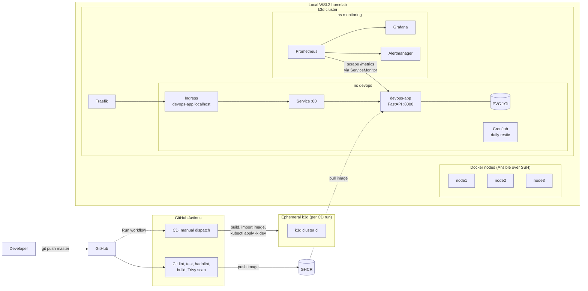

# Architecture

## Overview

The platform has three layers:

1. **Delivery** — GitHub Actions builds, scans and publishes the container image to GHCR. A manual workflow deploys it to a Kubernetes cluster.
2. **Runtime** — a FastAPI service running in k3d (k3s in Docker), exposed through Traefik.
3. **Operations** — Prometheus and Grafana for metrics, a daily restic backup CronJob, and Ansible-managed Docker nodes that stand in for VMs.

## Components

| Component | Where | Purpose |
|-----------|-------|---------|
| FastAPI app | `app/` | `/`, `/healthz` (liveness), `/readyz` (checks the database), `/metrics`, CRUD on `/items` |
| Container image | `app/Dockerfile` | Multi-stage build, runs as UID 1000, `HEALTHCHECK` on `/healthz` |
| CI pipeline | `.github/workflows/ci.yml` | On every push and PR: lint, test, Hadolint, build, Trivy scan. On master pushes it also publishes to GHCR |
| CD pipeline | `.github/workflows/cd.yml` | Manual (`workflow_dispatch`). Creates a throwaway k3d cluster, applies `k8s/overlays/dev`, smoke-tests the app |
| Kubernetes manifests | `k8s/base`, `k8s/overlays/{dev,prod}` | Deployment, Service, Ingress, PVC, ConfigMap, ServiceAccount, kustomize overlays |
| Docker nodes | `infra/nodes/` | Three Ubuntu containers running sshd, used as Ansible targets |
| Ansible | `ansible/` | `common` role (packages, SSH hardening, motd) and `node_exporter` role. Idempotent |
| Monitoring | `monitoring/` | kube-prometheus-stack values, ServiceMonitor for the app, alert rules, Grafana dashboard JSON |
| Backup | `backup/` | restic backup and restore-test scripts, daily CronJob |

## Data flows

**Request path.** Client → Traefik (`devops-app.localhost`) → Service `devops-app:80` → pod `:8000` → SQLite at `/data/app.db` on the PVC.

**Image path.** Push to master → CI builds and tags `sha-<commit>` and `master` → GHCR. CD builds `devops-app:latest` locally and imports it into the ephemeral cluster, so it never pulls from GHCR.

**Metrics path.** Prometheus scrapes `/metrics` on the app every 30 seconds through the ServiceMonitor. `PrometheusRule` alerts evaluate in the `monitoring` namespace.

**Backup path.** The CronJob runs at 02:00 daily, mounts the app data read-only, and runs `restic backup`, `restic check`, and `restic forget --prune` with a 7 daily / 4 weekly / 12 monthly retention policy.

## Known limitations

These are real gaps in the current repo, not hypotheticals.

- **Backups live on one node's disk.** The restic repository is on a 5Gi `local-path` PVC. There is no off-site copy yet, so a lost disk loses the backups too.
- **Docker-node scrape depends on Ansible.** The `docker-nodes` targets (`host.k3d.internal:9100-9102`) only come up after `make provision` installs node_exporter in the containers. That step needs Linux and has not been re-run since this change.
- **Grafana dashboards are not provisioned.** `make monitoring-up` installs the stack and the alert rules, but does not load `monitoring/dashboards/app-metrics.json`.
- **SQLite on one replica.** The app is single-writer, so the dev overlay runs one replica. Scaling out needs a different database.
- **Self-hosted runner is incomplete.** The in-cluster runner registers and picks up jobs, but its pod cannot reach the Kubernetes API server. It lives on the `self-hosted-runner` branch, not master.
- **restore-test wipes the dev app's database.** It runs in the `devops` namespace and deletes `/data/app.db` after a successful backup. Run it only against a dev cluster.
