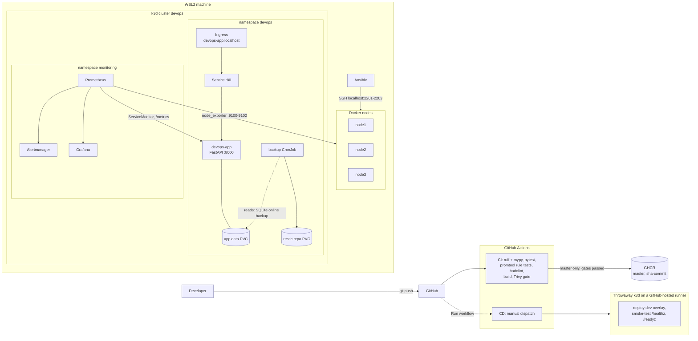

# Architecture

## Overview

The platform has three layers:

1. **Delivery.** GitHub Actions lints, tests and scans every push, and publishes the image to GHCR from master. A manual workflow deploys to a throwaway cluster and smoke-tests it.
2. **Runtime.** A FastAPI service in k3d (k3s in Docker), exposed through Traefik, with SQLite on a persistent volume.
3. **Operations.** Prometheus, Alertmanager and Grafana for metrics and alerts, a daily restic backup CronJob, and Ansible-managed Docker containers that stand in for VMs.

The local cluster runs an image built on the machine and imported with `k3d image import`; it does not pull from GHCR. The `prod` overlay references the GHCR image but is not deployed anywhere.

## Components

| Component | Where | Purpose |
|-----------|-------|---------|
| FastAPI app | `app/` | `/`, `/healthz` (liveness), `/readyz` (checks the database), `/metrics`, CRUD on `/items`. Database endpoints run in a thread pool; one middleware records request count and latency per route pattern and real status |
| Container image | `app/Dockerfile` | Multi-stage build, runs as UID 1000, `HEALTHCHECK` on `/healthz`, no pip/setuptools/wheel in the runtime image |
| CI pipeline | `.github/workflows/ci.yml` | On every push and PR: ruff + mypy, pytest, promtool alert-rule tests, hadolint. Then build, a Trivy SARIF report, and a Trivy gate (fixable HIGH/CRITICAL fail). On master pushes the image goes to GHCR |
| CD pipeline | `.github/workflows/cd.yml` | Manual. Builds the image, creates a throwaway k3d cluster, applies `k8s/overlays/dev`, smoke-tests `/healthz` and `/readyz` |
| Kubernetes manifests | `k8s/base`, `k8s/overlays/{dev,prod}` | Deployment, Service, Ingress, PVC, ConfigMap, ServiceAccount, kustomize overlays |
| Docker nodes | `infra/nodes/` | Three Ubuntu containers. A startup script installs the mounted SSH public key, starts enabled init scripts, then runs `sshd` as PID 1 |
| Ansible | `ansible/` | `common` role (packages, timezone, SSH hardening, motd) and `node_exporter` role (systemd or SysV init, depending on the host). Run from WSL; idempotent |
| Monitoring | `monitoring/` | kube-prometheus-stack values (chart pinned to 92.16.0), ServiceMonitor, alert rules with promtool tests, dashboard JSON wrapped in a ConfigMap for Grafana's sidecar |
| Backup | `backup/` | Daily CronJob (SQLite online backup, then restic), restore Job, restore test |
| Shared scripts | `ci/`, `scripts/` | Lint, test, rule-test, build and scan scripts used by the Makefile and CI; toolchain check/install |

## Data flows

**Request path.** Client → Traefik (`Host: devops-app.localhost`, host port 8080) → Service `devops-app:80` → pod `:8000` → SQLite at `/data/app.db` on the PVC.

**Rolling restart.** With `maxSurge: 1` and `maxUnavailable: 0`, the new pod must pass its readiness probe before the old pod is stopped. The old pod then runs a 10-second `preStop` sleep, so it keeps serving while it is removed from the Service and Traefik stops routing to it, and only then receives SIGTERM (`terminationGracePeriodSeconds: 30`). Measured: 0 failed requests out of about 1,500 in each of several restarts, against 24 failures before the `preStop` sleep was added.

**Image path.** Push → CI gates → on master, the image is pushed to GHCR as `master` and `sha-<commit>`. Locally, `make deploy` builds `devops-app:latest`, imports it into k3d, and restarts the deployment. CD builds and imports its own copy into a throwaway cluster.

**Metrics path.** Prometheus scrapes the app's `/metrics` every 30 seconds through the ServiceMonitor, and the nodes' node_exporter through `host.k3d.internal:9100-9102`. Four alert rules are evaluated: AppDown (`up == 0`, or no `up` series at all when there are no pods), HighErrorRate (5xx share of requests above 5% for 2 minutes), HighLatency (p95 above 0.5 s for 3 minutes), NodeExporterDown. Grafana's sidecar loads the app dashboard from a labelled ConfigMap.

**Backup path.** The CronJob runs at 02:00. Its init container opens the live database read-only and copies it with SQLite's online backup API, then runs `PRAGMA integrity_check` on the copy. The restic container backs up that copy, runs `restic check`, and applies `forget --prune` with 7 daily / 4 weekly / 12 monthly retention. The restore Job restores the latest snapshot over `/data/app.db`.

## Known limitations

- **The systemd branch of the node_exporter role is untested.** The Docker nodes have no systemd, so only the SysV init path has run.
- **`make deploy` always restarts the app**, because the dev image tag is always `latest`. The restart drops no requests.
- **Backups live on one node's disk.** The restic repository is a 5Gi `local-path` PVC with no off-site copy.
- **One snapshot per day.** Retention keeps the newest snapshot of each day, so a manual backup replaces that day's scheduled one.
- **SQLite on one replica.** The app is single-writer; scaling out needs a different database.
- **`make restore-test` wipes and restores the dev database** and leaves its test items behind. Run it only against a dev cluster.
- **Single machine only.** Nothing has been deployed beyond k3d on one machine; the `prod` overlay is a template.
