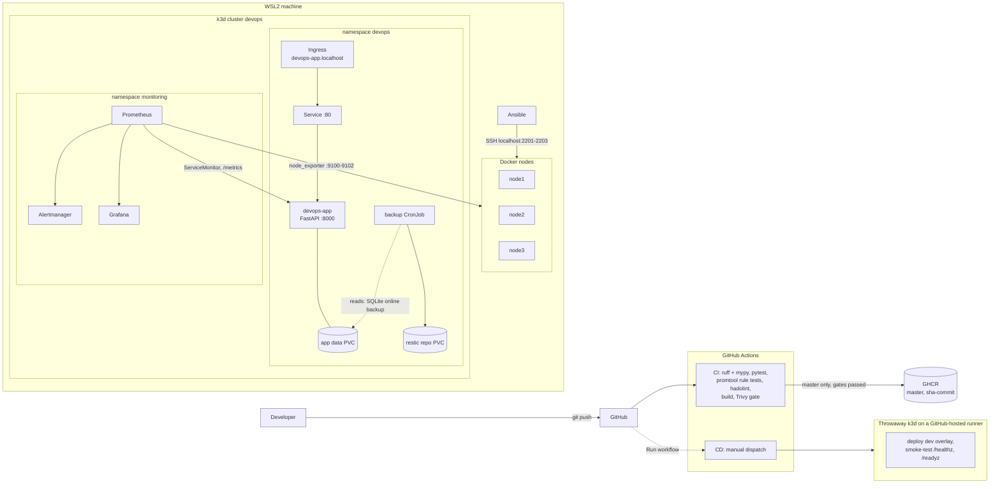
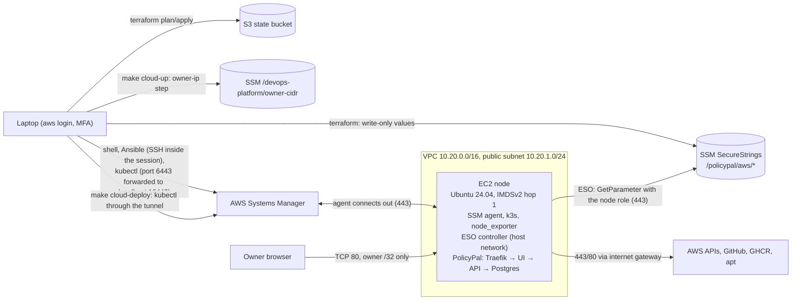
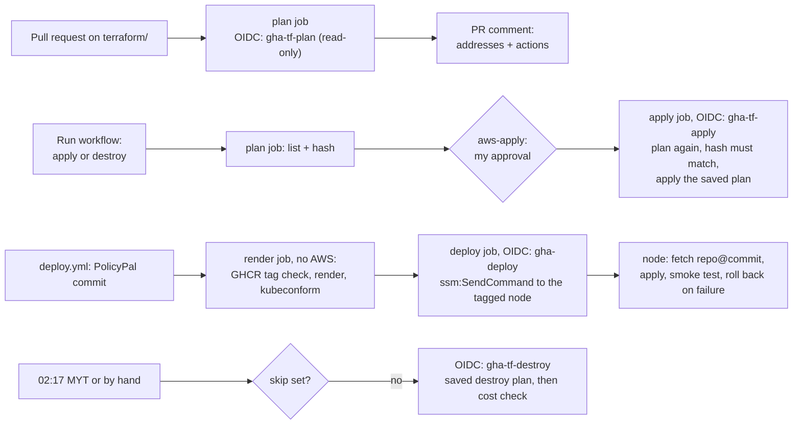

# Architecture

## Overview

The platform has three layers:

1. **Delivery.** GitHub Actions lints, tests and scans every push, and publishes the image to GHCR from master. A manual workflow deploys to a throwaway cluster and smoke-tests it. For AWS, three workflows plan and apply the ephemeral stack, deploy PolicyPal to the node and destroy the stack every night, each job with its own short-lived OIDC role.
2. **Runtime.** A FastAPI service in k3d (k3s in Docker), exposed through Traefik, with SQLite on a persistent volume.
3. **Operations.** Prometheus, Alertmanager and Grafana for metrics and alerts, a daily restic backup CronJob, and Ansible-managed Docker containers that stand in for VMs.

The local cluster runs an image built on the machine and imported with `k3d image import`; it does not pull from GHCR. The `prod` overlay references the GHCR image but is not deployed anywhere.

## Components

| Component | Where | Purpose |
|-----------|-------|---------|
| FastAPI app | `app/` | `/`, `/healthz` (liveness), `/readyz` (checks the database), `/metrics`, CRUD on `/items`. Database endpoints run in a thread pool; one middleware records request count and latency per route pattern and real status |
| Container image | `app/Dockerfile` | Multi-stage build, runs as UID 1000, `HEALTHCHECK` on `/healthz`, no pip/setuptools/wheel in the runtime image |
| CI pipeline | `.github/workflows/ci.yml` | On every push and PR: ruff + mypy, pytest, promtool alert-rule tests, hadolint. Then build, a Trivy SARIF report, and a Trivy gate (fixable HIGH/CRITICAL fail). On master pushes the image goes to GHCR |
| CD pipeline | `.github/workflows/cd.yml` | Manual. Builds the image, creates a throwaway k3d cluster, applies `k8s/overlays/dev`, smoke-tests `/healthz` and `/readyz` |
| Kubernetes manifests | `k8s/base`, `k8s/overlays/{dev,prod}` | Deployment, Service, Ingress, PVC, ConfigMap, ServiceAccount, kustomize overlays |
| Docker nodes | `infra/nodes/` | Three Ubuntu containers. A startup script installs the mounted SSH public key, starts enabled init scripts, then runs `sshd` as PID 1 |
| Ansible | `ansible/` | `common` role (packages, timezone, SSH hardening, motd) and `node_exporter` role (systemd or SysV init, depending on the host), run from WSL against the Docker nodes (`site.yml`) and, with the `k3s` role, against the AWS node (`aws-node.yml`) over SSH inside Session Manager. Idempotent on both. `make ansible-check` lints both playbooks. See ADR 013 |
| k3s on the AWS node | `ansible/roles/k3s` | Single-server k3s v1.36.6+k3s1 with bundled Traefik, ServiceLB, local-path and metrics-server; installer checked against a recorded sha256; Secrets encrypted at rest; admin kubeconfig root-only on the node. The role touches only the node: `playbooks/aws-node.yml` then copies the kubeconfig to the laptop (mode 600) pointing at the SSM tunnel on `localhost:16443`, with the port and path in `inventory/group_vars/aws.yml`. Rebuilt every session (`make cloud-rebuild`, about three minutes) |
| PolicyPal manifests | `k8s/policypal/base`, `k8s/policypal/overlays/{local,aws}` | PolicyPal from its public GHCR image: Postgres + pgvector StatefulSet (5Gi local-path), API Deployment (one replica, `Recreate`, extractive mode, uploads PVC, init container waiting for Postgres), Streamlit UI Deployment, ClusterIP Services, and an Ingress that reaches only the UI. Non-root, no capabilities, no service account token. `local` (k3d, host `policypal.localhost`) and `aws` (any host) deploy the same objects and pin the same quoted commit tag. Rendered by `scripts/render-k8s.sh` (pinned kustomize), validated by `make k8s-check` (kubeconform `-strict`, Kubernetes 1.36.6) and `tests/test_k8s_policy.py`. See ADRs 014 and 015 |
| PolicyPal deploy scripts | `scripts/{policypal-secrets,deploy-policypal,smoke-test,node-ip}.sh` | On k3d, create the two Secrets once with random values (never printed); apply the rendered overlay, wait up to 2 minutes for the Secrets (one `kubectl wait --for=create` each), wait for the rollouts, smoke-test, and roll back each Deployment the deploy changed if anything fails. `make policypal-local` (k3d) and `make cloud-deploy` / `make cloud-smoke` (AWS, through the tunnel) |
| PolicyPal's secrets on AWS | `terraform/persistent/policypal_secrets.tf`, `k8s/policypal/overlays/aws/externalsecret-*.yaml` | `/policypal/aws/db-password` and `/policypal/aws/admin-token`: SSM SecureStrings (Standard, `aws/ssm`), written by Terraform through write-only arguments from ephemeral random values, so they're in neither the plan nor the state (`make check-state-secrets` counts copies: 0). Only a version is stored; raising it in a commit rotates the value. The node role may `ssm:GetParameter` on `/policypal/aws/*` only. Two ExternalSecrets make `policypal-db` and `policypal-admin`, hourly. See ADR 016 |
| External Secrets Operator | `k8s/platform/external-secrets`, `scripts/{install,render}-eso.sh` | Chart 2.15.0 pinned in `chart.env`, read by both the install (`make cloud-addons`) and the checks. The controller runs on the host network (the only way to IMDSv2 with hop limit 1), is replaced rather than rolled (`Recreate`), and declares both its host ports (8080 metrics, 8082 health with a liveness probe); the webhook and cert-controller stay in the pod network. A `ClusterSecretStore` reads Parameter Store with the node's role and serves only the `policypal` namespace, which enforces Pod Security "baseline" (no host-network pods). See ADR 017 |
| Secret scanning | `.gitleaks.toml`, `.gitleaksignore`, `ci/gitleaks.sh`, `.pre-commit-config.yaml`, `.github/workflows/secret-scan.yml` | gitleaks (pinned image) with its default rules plus `plain-password-assignment`; the full history in CI on every pull request and weekly, staged changes in a pre-commit hook; values always redacted. Two known findings from `7ca581f` ignored by fingerprint |
| Monitoring | `monitoring/` | kube-prometheus-stack values (chart pinned to 92.16.0), ServiceMonitor, alert rules with promtool tests, dashboard JSON wrapped in a ConfigMap for Grafana's sidecar |
| Backup | `backup/` | Daily CronJob (SQLite online backup, then restic), restore Job, restore test |
| Terraform persistent stack (AWS) | `terraform/persistent` | S3 state bucket (versioned, SSE-S3, TLS-only, native lockfile), `zero-spend` and `monthly-cap` budgets, and the USD 15 budget action that denies new spend. Also the node's role (11 SSM-agent actions, plus `GetParameter` on `/policypal/aws/*`), its instance profile, the SSM parameter `/devops-platform/owner-cidr`, and PolicyPal's two SecureStrings. Only $0-at-rest resources; applied from the laptop. See ADRs 005–007 and 016 |
| Terraform ephemeral stack (AWS) | `terraform/envs/aws`, `terraform/modules/{network,compute}` | Everything billed by the hour, created with `make cloud-up` and destroyed with `make cloud-down` every session. `network`: one VPC with a public subnet and internet gateway (no NAT, Elastic IP or endpoints). `compute`: one Ubuntu 24.04 node (allowlisted type, IMDSv2 hop limit 1, encrypted gp3, on-demand or Spot) and its security group, allowing TCP 80 from the owner's /32 only. It finds the instance profile and owner IP by name, not through the persistent state. See ADRs 008–012 |
| GitHub OIDC roles (AWS) | `terraform/persistent/github_oidc.tf`, `github_permissions.tf` | GitHub's OIDC provider and four roles, each trusting exact token subjects (GitHub's immutable form, `toolikheng@149467084/devops-platform@1406132198`): `gha-tf-plan` (pull requests and master, read-only), `gha-tf-apply` (environment `aws-apply`, my approval), `gha-tf-destroy` (`aws-nightly`), `gha-deploy` (`aws-deploy`). No role can change IAM; the apply role's Deny statements repeat the cost rules for `RunInstances`; deletes need the ephemeral stack's tags ([ADR 020](decisions/020-one-oidc-role-per-ci-job.md)) |
| AWS workflows | `.github/workflows/{terraform,deploy,nightly-destroy}.yml`, `ci/{ephemeral-stack,plan-summary,nightly-skip,deploy-render,deploy-over-ssm,kubeconform}.sh` | Every Terraform run of the workflows is in `ci/ephemeral-stack.sh` (`plan`, `apply <hash>`, `nightly`); the YAML only wires inputs, roles and approvals. `terraform.yml`: PR plan comment (addresses and actions only), manual apply or destroy that plans again after approval and applies the saved plan only if the change list's hash matches. `deploy.yml`: checks the PolicyPal tag on GHCR, renders and validates the overlay with no AWS access, then sends it to the node through SSM Run Command. `nightly-destroy.yml`: 02:17 MYT (off the hour, where GitHub's scheduler is busiest), skippable for up to 7 days (`make skip-nightly-destroy`), then the cost check |
| Deploy on the node | `scripts/node-deploy.sh` | Run by SSM Run Command as root from a checkout of the workflow's commit: k3s's own kubeconfig, the node's private address from IMDSv2 for the smoke test, then `deploy-policypal.sh` with the manifests CI validated ([ADR 021](decisions/021-deploy-through-ssm-run-command.md)) |
| Shared scripts | `ci/`, `scripts/` | Lint, test, rule-test, build and scan scripts used by the Makefile and CI; toolchain check/install |

## Data flows

**Request path.** Client → Traefik (`Host: devops-app.localhost`, host port 8080) → Service `devops-app:80` → pod `:8000` → SQLite at `/data/app.db` on the PVC.

**Rolling restart.** With `maxSurge: 1` and `maxUnavailable: 0`, the new pod must pass its readiness probe before the old pod is stopped. The old pod then runs a 10-second `preStop` sleep, so it keeps serving while it is removed from the Service and Traefik stops routing to it, and only then receives SIGTERM (`terminationGracePeriodSeconds: 30`). Measured: 0 failed requests out of about 1,500 in each of several restarts, against 24 failures before the `preStop` sleep was added.

**Image path.** Push → CI gates → on master, the image is pushed to GHCR as `master` and `sha-<commit>`. Locally, `make deploy` builds `devops-app:latest`, imports it into k3d, and restarts the deployment. CD builds and imports its own copy into a throwaway cluster.

**Metrics path.** Prometheus scrapes the app's `/metrics` every 30 seconds through the ServiceMonitor, and the nodes' node_exporter through `host.k3d.internal:9100-9102`. Four alert rules are evaluated: AppDown (`up == 0`, or no `up` series at all when there are no pods), HighErrorRate (5xx share of requests above 5% for 2 minutes), HighLatency (p95 above 0.5 s for 3 minutes), NodeExporterDown. Grafana's sidecar loads the app dashboard from a labelled ConfigMap.

**Backup path.** The CronJob runs at 02:00. Its init container opens the live database read-only and copies it with SQLite's online backup API, then runs `PRAGMA integrity_check` on the copy. The restic container backs up that copy, runs `restic check`, and applies `forget --prune` with 7 daily / 4 weekly / 12 monthly retention. The restore Job restores the latest snapshot over `/data/app.db`.

**AWS session path.** `make cloud-up` first writes this machine's public IP as a /32 to `/devops-platform/owner-cidr` (its `owner-ip` step), then plans the ephemeral stack, which reads that parameter and the `devops-platform-node` instance profile by name, and applies after confirmation. The node boots with a public IPv4 and reaches AWS, GitHub, GHCR and the apt mirrors through the internet gateway on ports 443 and 80. Its SSM agent registers with AWS using the instance role, whose short-lived credentials it gets from IMDSv2. `aws ssm start-session` then opens a shell through AWS, with no inbound port. The only inbound rule is TCP 80 from the owner's /32. `make cloud-config` then writes the inventory from `terraform output` (host = instance ID) and runs Ansible: SSH goes inside a Session Manager session (`AWS-StartSSHSession`), configures the node, installs k3s and copies the kubeconfig back. `make cloud-tunnel` forwards the node's 6443 to `localhost:16443` (`AWS-StartPortForwardingSession`), and kubectl uses that. The node pulls k3s and its images from GitHub and Docker Hub over 443. `make cloud-down` destroys the stack and runs `make cost-check`.

**Secrets on AWS.** Terraform (persistent stack, from the laptop) writes each secret to SSM Parameter Store through a write-only argument. On a new node, `make cloud-addons` installs External Secrets Operator through the tunnel. Its controller, on the host network, gets the node role's credentials from IMDSv2 and reads the parameters through the `ClusterSecretStore`; pods in the pod network can't get a token (hop limit 1), and the `policypal` namespace refuses host-network pods. The ExternalSecrets in the `aws` overlay tell it which parameter becomes which Secret key; it refreshes them hourly, and a forced sync after a rotation takes about a second. Pods read the Secrets as environment variables, so a rotated value reaches the API at its next restart.

**PolicyPal on AWS.** `make cloud-deploy` (with the tunnel open and ESO installed) reads the node's public IP from `terraform output`, renders the `aws` overlay and applies it; ESO makes the `policypal-db` and `policypal-admin` Secrets from the ExternalSecrets in that apply, and the deploy waits for them. The node pulls `ghcr.io/toolikheng/policypal:<commit>` and `pgvector/pgvector:0.8.7-pg17`. Postgres starts; the API's init container waits for `pg_isready`, then the API runs its migrations, ingests the 8 sample policies (119 chunks; unchanged files are skipped on later starts) and listens on 8000. A browser on the owner's IP → TCP 80 → Traefik → Service `policypal-ui:8501` → Streamlit, which calls `policypal-api:8000` inside the cluster → Postgres. The smoke test reaches the API through `kubectl port-forward` over the same tunnel, and checks the UI through the public IP.

**CI/CD on AWS.** A job that needs AWS asks GitHub for an OIDC token; STS checks it against GitHub's provider and the role's trust policy (audience and exact subject) and returns credentials for one hour at most. The role ARN is built from the `AWS_ACCOUNT_ID` secret, so the account ID stays masked in the public logs. A pull request touching `terraform/` gets a read-only plan (`-lock=false`) and a comment listing each change. A manual apply or destroy shows the same list and its hash; after my approval in `aws-apply` the job plans again and applies its saved plan only if the hash matches. `deploy.yml` asks GHCR whether the image exists, renders and validates the overlay, then sends it, compressed, inside one `AWS-RunShellScript` command to the instance tagged as the ephemeral stack; the node fetches this repo at the same commit and deploys, smoke-tests and rolls back on its own. Nothing connects to the node, and no cluster credential leaves it. The persistent stack, which holds IAM, is applied from the laptop only.

## Known limitations

- **`make deploy` always restarts the app**, because the dev image tag is always `latest`. The restart drops no requests.
- **Backups live on one node's disk.** The restic repository is a 5Gi `local-path` PVC with no off-site copy.
- **One snapshot per day.** Retention keeps the newest snapshot of each day, so a manual backup replaces that day's scheduled one.
- **SQLite on one replica.** The app is single-writer; scaling out needs a different database.
- **`make restore-test` wipes and restores the dev database** and leaves its test items behind. Run it only against a dev cluster.
- **The app runs on one machine only.** It has not been deployed beyond k3d; the `prod` overlay is a template. The AWS node exists only during a session.
- **The AWS node is a single instance** with no high availability. A Spot interruption or a terminated instance takes it down until it is rebuilt (`make cloud-rebuild`, then `make cloud-deploy`).
- **PolicyPal's data lasts one session.** Postgres and the uploads volume are folders on the node's disk; there is no backup yet.
- **A rotated secret reaches the API only when it restarts**, and the database password also needs `ALTER ROLE` in Postgres (runbook).
- **The API is down during each PolicyPal deploy** (`Recreate`: one process, one ReadWriteOnce volume), and until the rollback if the new version fails.
- **`kubectl apply` always reports the Postgres StatefulSet as configured**: it replaces `volumeClaimTemplates` as a whole and the server adds defaults. The generation doesn't change and nothing restarts.
- **Every host-network process on the node shares one IAM role** (the SSM agent, k3s, ESO's controller), and the cluster admin credentials are copied to the laptop. Both are fine for one owner; a team would use per-pod IAM and short-lived Kubernetes credentials. PolicyPal's namespace refuses host-network pods (ADR 017).
- **The nightly destroy depends on GitHub's scheduler.** A scheduled run can start late (5 h 30 min on the first night) or be skipped, and schedules are disabled after 60 days without activity in the repo. The budget alerts and `make cost-check` are the backup. There is deliberately no time window, so a late run can destroy a stack in use; `make skip-nightly-destroy` protects a planned session (8 hours, or `UNTIL=` for longer).
- **Repository admins can bypass the environments' protection rules** (`can_admins_bypass`, GitHub's default). With one owner that changes nothing; a team would turn it off so the approval on `aws-apply` binds admins too.
- **A CI deploy shows the node's output only when the command ends**, and Run Command returns at most 24,000 characters of output and 8,000 of errors. Whoever may send the command is root on the node; only jobs in `aws-deploy` (master only) can.
